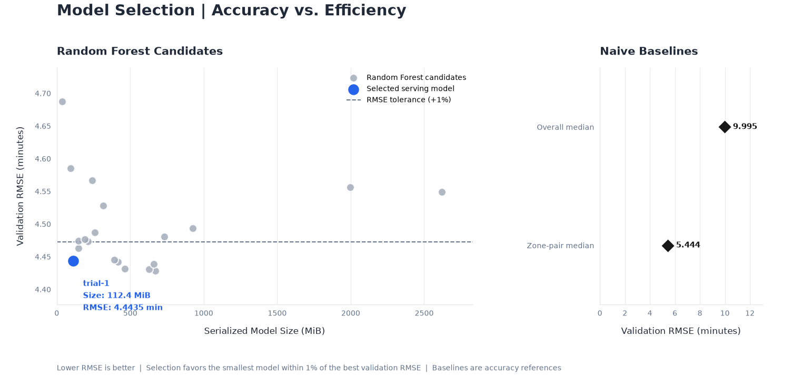
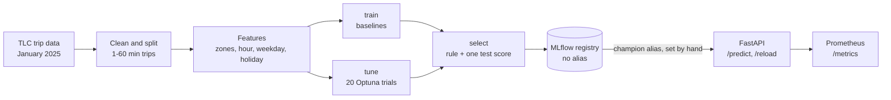
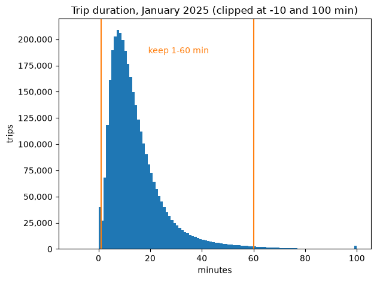

# NYC Taxi Trip Duration Prediction

[](https://github.com/HassanHijaze/mle-model-deployment-project/actions/workflows/ci.yml)

Predicts how long a NYC yellow-taxi trip will take from what is known at pickup: pickup zone, drop-off
zone and pickup time. A reproducible pipeline trains and compares models on January 2025 data, registers
the selected one in MLflow, and a FastAPI service serves it with safe hot reload and Prometheus metrics.

**Result:** the model selected for serving reaches a **test RMSE of 4.4415 minutes** (Jan 26–31, scored
once), against 5.4237 for the best naive baseline.
**Stack:** scikit-learn · Optuna · MLflow (PostgreSQL) · FastAPI · Prometheus · Docker Compose

## Results

Time-based split of 1–60 minute trips: train Jan 1–20, validation Jan 21–25, test Jan 26–31. Every model
learns from the training days only; the test days are used once. RMSE in minutes, from the latest
`select` run ([model_serving_selection.ipynb](notebooks/model_serving_selection.ipynb)).

| Model | Validation RMSE | Test RMSE | Size |
|---|---:|---:|---:|
| Overall median (naive) | 9.9949 | 10.1225 | – |
| Zone-pair median (naive) | 5.4437 | 5.4237 | – |
| Random Forest baseline | 4.4771 | 4.4837 | – |
| **Selected: trial-1** (Optuna) | **4.4435** | **4.4415** | **112.4 MiB** |

Selection rule, fixed before the results:
1. Find the lowest validation RMSE among the RF baseline and the 20 Optuna trials.
2. Every candidate within 1% of it counts as tied (9 of 21 were).
3. The smallest tied model wins: trial-1, 0.34% above the best RMSE.



## How it works



| Command | What it does |
|---|---|
| `uv run nyc-taxi data` | Downloads January 2025 and builds the zone table |
| `uv run nyc-taxi train` | Overall median, zone-pair median and RF baseline, scored on validation |
| `uv run nyc-taxi tune` | 20 Optuna trials: validation RMSE, MAE and model size |
| `uv run nyc-taxi select` | Applies the rule, scores winner and baselines once on test, registers the winner |
| `uv run nyc-taxi all` | data → train → tune → select |
| `uv run nyc-taxi verify <version>` | Loads a registered version in a fresh process and checks it |

## What the data showed

From [exploration.ipynb](notebooks/exploration.ipynb) (training days only for the time patterns).


- **Hour:** the median trip takes 10.4 min at 6 am and 12.2 min at 2 pm, so the pickup hour is a feature.
- **Weekday:** Thursday is the slowest day (12.1 min), Sunday the fastest (10.8 min).
- **Holidays:** no morning rush (9.4 vs 12.0 min at 8–10 am), so a holiday flag is a feature.



- **Cleaning:** 97.9% of trips last 1–60 minutes; the rest are mostly recording errors and are dropped.

## Quick start

```bash
uv sync && cp .env.example .env          # once; set your own passwords and ADMIN_TOKEN
docker compose up -d postgres mlflow     # MLflow UI: http://localhost:5002
uv run nyc-taxi all                      # prints the registered version
uv run nyc-taxi verify <version>         # must print OK
# set the "champion" alias on that version in the MLflow UI, then:
docker compose up -d api
export $(grep ADMIN_TOKEN .env)
curl -X POST http://localhost:8000/reload -H "X-Admin-Token: $ADMIN_TOKEN"
curl -X POST http://localhost:8000/predict -H "Content-Type: application/json" \
  -d '{"PULocationID": 161, "DOLocationID": 236, "pickup_datetime": "2025-01-27T08:30:00"}'
```

Promotion and rollback: [docs/operations.md](docs/operations.md).

## API

| Endpoint | Description |
|---|---|
| `POST /predict` | Trip duration in minutes, with the model version that answered |
| `POST /reload` | Loads the current `champion`, validates it, then swaps; needs `X-Admin-Token` |
| `GET /live` · `GET /ready` | The process is up · a validated model is loaded |
| `GET /health` · `GET /metrics` | Model and last reload status · Prometheus metrics |

```text
request:  {"PULocationID": 161, "DOLocationID": 236, "pickup_datetime": "2025-01-27T08:30:00"}
response: {"duration_minutes": <minutes>, "model_version": "<registered version>"}
```

Zone IDs 1–265, New York local time without a timezone. Training and the API share `src/features.py`; each
model carries its zone table and feature schema, which `/reload` validates before swapping (on failure the
previous model keeps serving). Errors share one format (`code`, `message`, `request_id`); logs are JSON lines.

## Tests and CI

| What | Command | CI job |
|---|---|---|
| Format, lint, types | `uv run ruff format --check .` · `uv run ruff check .` · `uv run mypy` | `lint` |
| Dependency vulnerabilities | `uv run pip-audit` on the exported lock file | `security` |
| Unit and API tests (fake models, no MLflow) | `uv run pytest` | `tests` |
| Docker images and Prometheus config | `docker build .` | `docker` |
| End-to-end on a throwaway stack: promote, upgrade, reject a broken version | `uv run pytest -m e2e tests/e2e` | `e2e` |
| Load test (1, 10, 50 users) | `uv run python tests/load/run_load_test.py` | local only |

## Monitoring

`GET /metrics` exposes request counts and latency by route, predictions and errors, the active model
version, model load time and reload failures. `docker compose up -d prometheus` scrapes it every 15 seconds;
query it at http://localhost:9090 (e.g. `taxi_api_model_info`, `taxi_api_request_duration_seconds_bucket`).
Load-test procedure and results template: [docs/benchmarks.md](docs/benchmarks.md).

## Limitations and next steps

**Limitations**
- One month of data: no seasons, weather or special events.
- Zone-level locations only, so trips within the same zone pair vary a lot.
- Only trips of 1–60 minutes are modelled and served.
- Every Random Forest is fitted on a 500,000-trip sample of the training days.

**Next steps**
- Train on several months and add traffic or weather data.
- Fit on all training trips and add model size to the Optuna objective.
- Return prediction ranges from the spread of the trees, most useful for airport trips.
- Run the load test and fill in [docs/benchmarks.md](docs/benchmarks.md).

## Project questions

**1. What is the RMSE of your final model?** 4.4415 minutes on the test days (Jan 26–31) for the selected
model, trial-1, computed once after selection.

**2. What would you do differently if you had more time?** Use more months and extra signals such as
traffic and weather, fit on all training trips instead of a sample, search for smaller models directly,
and return prediction ranges instead of a single number.
