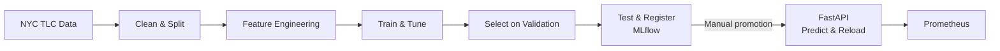
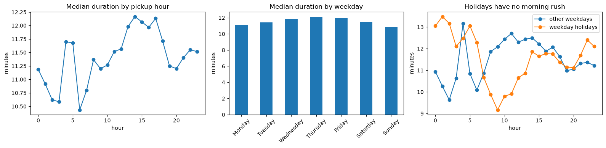

# NYC Taxi Trip Duration Prediction

[](https://github.com/HassanHijaze/mle-model-deployment-project/actions/workflows/ci.yml)

An end-to-end ML system predicting NYC yellow-taxi trip duration from pickup/drop-off zones and pickup time. Includes reproducible training, validation-based model selection, MLflow registration, FastAPI serving, safe model reloads, CI, and Prometheus monitoring.

**Result:** 4.4415 min test RMSE · **Serving model:** 112.4 MiB  
**Stack:** scikit-learn · Optuna · MLflow · FastAPI · PostgreSQL · Docker Compose · Prometheus

[Results](#results) · [Architecture](#architecture) · [Data](#data-insights) · [Quick Start](#quick-start) · [API](#api) · [Tests](#tests-and-ci) · [Benchmarks](#monitoring-and-benchmarks) · [Limitations](#limitations)

## Results

January 2025 trips (1–60 min), split chronologically: **train Jan 1–20 · validation Jan 21–25 · test Jan 26–31**.

| Model | Val RMSE | Test RMSE | Size |
|---|---:|---:|---:|
| Overall median | 9.9949 | 10.1225 | — |
| Zone-pair median | 5.4437 | 5.4237 | — |
| Random Forest baseline | 4.4771 | 4.4837 | — |
| **Selected RF (trial-1)** | **4.4435** | **4.4415** | **112.4 MiB** |

**Selection rule:** From 20 Optuna trials plus the RF baseline, choose the smallest model within **1% of the best validation RMSE**. Nine of 21 candidates qualified; the winner was only 0.34% above the best validation score.


Model selection uses validation data, not test data. Earlier exploratory experiments inspected the January test period; an independent future-month evaluation remains future work.

## Architecture



**Pipeline:** `uv run nyc-taxi all` runs data → train → tune → select. Registration does not automatically promote the model. See [model selection notebook](notebooks/model_serving_selection.ipynb) and [operations guide](docs/operations.md).

## Data Insights

[Exploratory analysis](notebooks/exploration.ipynb) shows differences in trip duration by hour, weekday, and holiday.



- **Time:** Median duration ranges from 10.4 min at 6 AM to 12.2 min at 2 PM.
- **Weekday:** Thursday is slowest (12.1 min); Sunday is fastest (10.8 min).
- **Cleaning:** 97.9% of trips fall within the retained 1–60 min range.


## Quick Start

```bash
uv sync
cp .env.example .env                 # Configure credentials and ADMIN_TOKEN
docker compose up -d postgres mlflow
uv run nyc-taxi all                  # Train, select, register
uv run nyc-taxi verify <version>     # Verify registered model
```

Assign the verified version the `champion` alias in the MLflow UI, then start the API:

```bash
docker compose up -d api
export ADMIN_TOKEN="$(grep '^ADMIN_TOKEN=' .env | cut -d= -f2-)"
curl -X POST http://localhost:8000/reload -H "X-Admin-Token: $ADMIN_TOKEN"
curl http://localhost:8000/ready
curl -X POST http://localhost:8000/predict \
  -H "Content-Type: application/json" \
  -d '{"PULocationID":161,"DOLocationID":236,"pickup_datetime":"2025-01-27T08:30:00"}'
```

## API

| Endpoint | Purpose |
|---|---|
| `POST /predict` | Predict duration and return model version |
| `POST /reload` | Authenticated, validated model hot reload |
| `GET /live`, `/ready` | Liveness and model readiness |
| `GET /health`, `/metrics` | Health status and Prometheus metrics |

Training and serving share `src/features.py`. Failed reloads preserve the previously serving model. See [operations guide](docs/operations.md).

## Tests and CI

CI checks formatting, linting, types, dependency vulnerabilities, unit/API tests, Docker builds, and end-to-end model promotion and rollback.

```bash
uv run pytest
uv run pytest -m e2e tests/e2e
uv run python tests/load/run_load_test.py --users 1 10
```

## Monitoring and Benchmarks

Prometheus collects HTTP latency, request counts, prediction errors, active model version, and reload metrics. Start with `docker compose up -d prometheus`.

**Locust benchmark:** Local Docker deployment, MLflow model version 8, two minutes per scenario.

| Users | p50 | p95 | p99 | Prediction RPS | Errors | Peak RAM |
|---|---:|---:|---:|---:|---:|---:|
| 1 | 77 ms | 80 ms | 82 ms | 0.89 | 0% | 627.6 MiB |
| 10 | 77 ms | 120 ms | 170 ms | 8.87 | 0% | 628.6 MiB |

Median latency remained stable as concurrency increased, with **zero request failures**. Results describe this workload, not maximum API capacity.

[Benchmark procedure](docs/benchmarks.md) · [Prometheus UI](http://localhost:9090)

## Limitations

- January 2025 only; no seasonal, traffic, or weather features.
- Zone-level pickup/drop-off locations; no exact routes.
- Predictions limited to trips lasting 1–60 minutes.
- Random Forest training uses a 500,000-trip sample.
- Future work: independent later-month evaluation, more training data, prediction intervals, and higher-concurrency stress tests.
